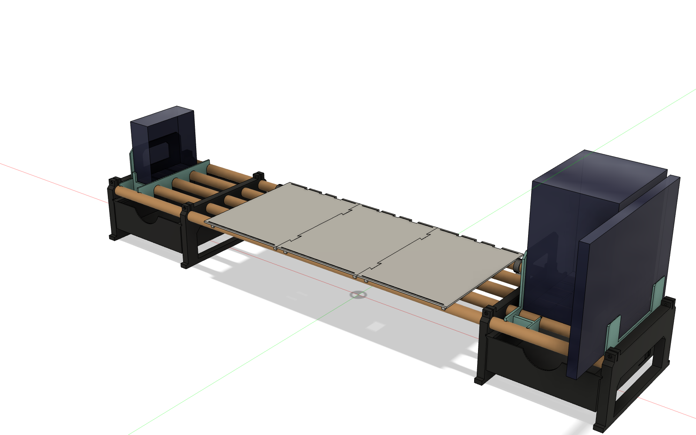
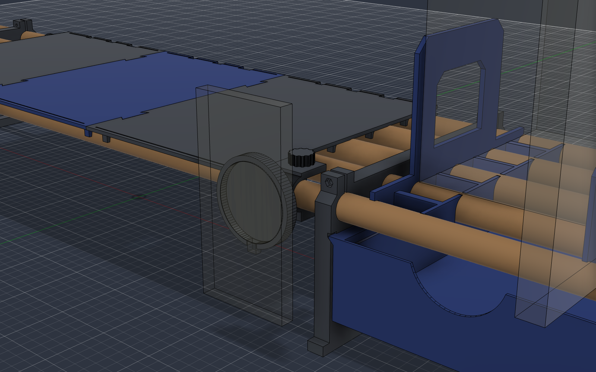
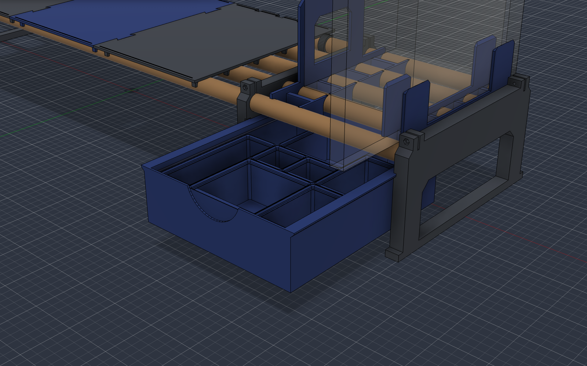
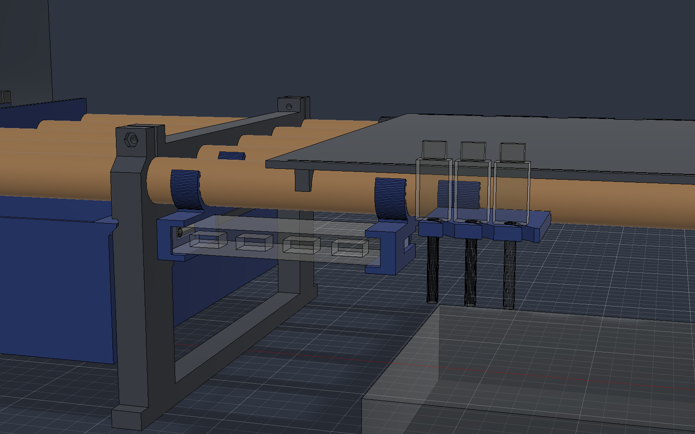
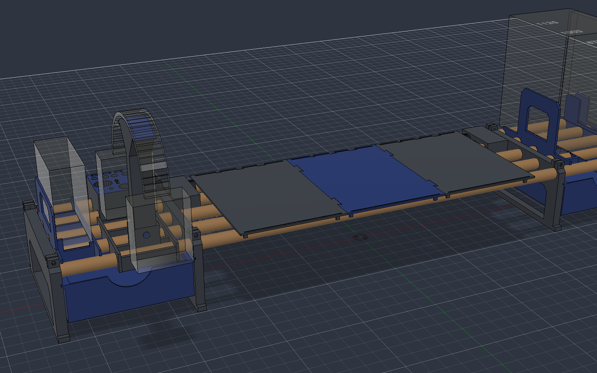
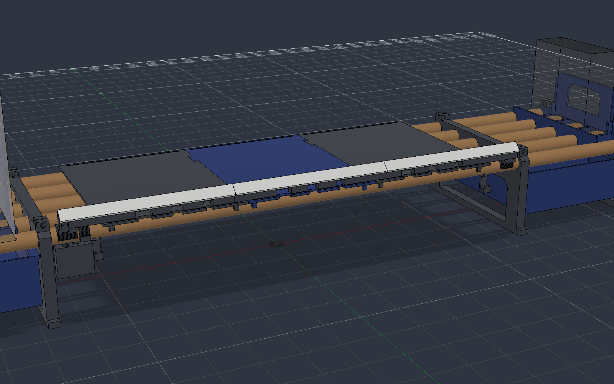

# Dowel Desk Shelf — monitor riser on five 20 mm wooden dowels

[Русская версия](README.ru.md)

A 3D-printed monitor riser / desk shelf that uses **five plain wooden dowels Ø20 × 1100 mm** as the frame.
Four printed legs hold the dowels, a three-piece deck sits under the monitor, and two drawers hang
in V-channels on both sides. Add-ons: MacBook stand with bookend, Mac mini stand, MagSafe phone mount,
Gridfinity inserts for the drawers, cable and USB-hub holders, cable tray and wall backlight (ESP32 + WLED).

> **Status: work in progress.** The design is fully modelled and checked in CAD (no interferences,
> drawer travel simulated), but only part of it has been printed so far. See
> [what is tested](#what-is-tested-and-what-is-not) before you commit 1.3 kg of filament.

## Key numbers

| | |
|---|---|
| Overall size | ≈ 1104 × 244 mm, deck surface at ≈ 118 mm above the desk |
| Deck | 540 × 244 mm, three tiles joined by dovetails |
| Clearance under the rods | 95 mm |
| Drawers | 190 × 224 × 62 mm outside, 186 × 220 inside, 145 mm travel, stop + removable |
| Dowels | 5 × Ø20 × 1100 mm, centres 50 mm apart, axis at 105 mm |
| Designed for | LG 29UC97C-B (6.2 kg). **No load rating is implied.** |
| Material | ABS (PETG should work, not tested); ≈ 1.34 kg for shelf + modules |
| Print time | ≈ 84 h at 0.20 mm, ≈ 65 h with the fast profiles in `source/orca` |
| **Minimum bed** | **245 × 200 mm** (legs and tiles are 244 mm long). Made on a FlyingBear Ghost 6 (255 × 210). |

## Bill of materials

- 5 wooden dowels Ø20 mm × 1100 mm (measure them — see [rods](docs/assembly.md#1-sort-and-prepare-the-rods)).
- 8 × M3 × 20 screws + 8 × M3 nuts (pinch clamps on the front and back rods, 2 per leg).
- Optional: electrical tape or adhesive heat-shrink (thin rods), a candle/paraffin (slides), rubber/EVA strip under the legs,
  VHB tape (MagSafe puck), felt pads.

## Repository layout

| Folder | Contents |
|---|---|
| [`stl/00-test-prints`](stl/00-test-prints) | Socket rings D20.2/20.4/20.6 and a drawer-slide coupon pair. **Print these first.** |
| [`stl/01-shelf`](stl/01-shelf) | Legs, deck tiles, drawers, rod clips, spacing gauge — already in print orientation |
| [`stl/02-modules`](stl/02-modules) | MacBook Air dock, bookend, vertical Mac mini stand (drop over the rods, no screws) |
| [`stl/03-magsafe`](stl/03-magsafe) | Tilting MagSafe puck mount for the front rod, printed M8 thumb screw + nut |
| [`stl/04-gridfinity`](stl/04-gridfinity) | Gridfinity baseplates sized for the drawers + 4 starter bins |
| [`stl/05-front-rod`](stl/05-front-rod) | Plug holders (1/2/3 cables) and a USB-hub cradle under the front rod |
| [`stl/06-storage`](stl/06-storage) | Cable tray under the deck, tool rail, headphone stand (experimental, heavy) |
| [`stl/07-backlight`](stl/07-backlight) | LED rail for wall backlight + ESP32-C3 Super Mini box |
| [`cad`](cad) | Fusion 360 archives (`.f3d`) and a STEP of the shelf. **`all_in_one.f3d`** — everything in one document, one component per set (toggle visibility) |
| [`source/fusion`](source/fusion) | Fusion 360 API scripts that generate everything (fully parametric) |
| [`source/orca`](source/orca) | OrcaSlicer profiles (ABS, Ghost 6) and the CLI slicing helper |
| [`docs`](docs) | [Printing](docs/printing.md) · [Assembly](docs/assembly.md) · [Known issues](docs/known-issues.md) · [Accessories](docs/accessories.md) |

## Which legs to print

The legs are the only parts that depend on your dowels.

- **End legs** (`leg_end_*_D20.4`) have blind sockets D20.4, 14 mm deep. A loose dowel gets a few turns of tape.
- **Inner legs**, the dowels pass through them. Two variants:
  - `leg_inner_*_D20.4` — all five sockets D20.4, for dowels that are really 20.0 mm. Start here.
  - `leg_inner_*_fitted_20.2-19.3-20.4-19.3-20.2` — the author's set: three good rods (20.0–20.1) in positions 1/3/5,
    two thin ones (19.0) in positions 2/4. Use as an example, or regenerate with your own sizes
    (`SOCK_INNER` in `source/fusion/deskshelf_v2_4c.py`).
- `rod_clip_D19.8` (snug on 20.0 rods) or `rod_clip_D20.2` (for fatter rods).

## Pictures

| | |
|---|---|
|  |  |
| Modules: MacBook dock, bookend, Mac mini stand | MagSafe mount on the front rod, tilt ±40° |
|  |  |
| Gridfinity in the right drawer (pulled out 145 mm) | USB hub cradle and plug holder |
|  |  |
| Cable tray, tool rail, headphone stand | Wall backlight rail and ESP32 box |

## What is tested and what is not

| Part | State |
|---|---|
| Socket rings, drawer-slide coupons (channel variant B) | ✅ printed, used to pick the clearances |
| Deck tile 1, end leg (right) | ✅ printed in ABS |
| Inner legs, drawers, other tiles, modules | ⏳ not printed yet — CAD-checked only |
| MagSafe v3, all accessories | 🧪 CAD-checked only |
| Load capacity, long-term creep of ABS on wood | ❌ not tested |

Read [known issues](docs/known-issues.md) — there are real lessons there (crooked dowels, 1 cm length differences,
thin dowels that no clamp can grip, a drawer-stop bug that was caught before printing).

## Credits and license

- Concept inspired by **GoCartDad — DadWel System: Modular Monitor Riser & Desk Shelf w/ Modular Drawers**
  ([Printables 1693920](https://www.printables.com/model/1693920-modular-monitor-riser-desk-shelf-w-modular-drawers), CC BY-NC-SA 4.0).
  This version is modelled from scratch for five Ø20 dowels and contains no mesh geometry from that model.
- Gridfinity system by **Zack Freedman** (MIT); the plates and bins here are a new implementation of the published profile.
- WLED: <https://kno.wled.ge>.

Designed by [@myratmyradov1997](https://github.com/myratmyradov1997) with Claude Code (Anthropic) driving Fusion 360 through its API.

Licensed under [CC BY-NC-SA 4.0](LICENSE): share and remix with attribution, non-commercial, same license.
