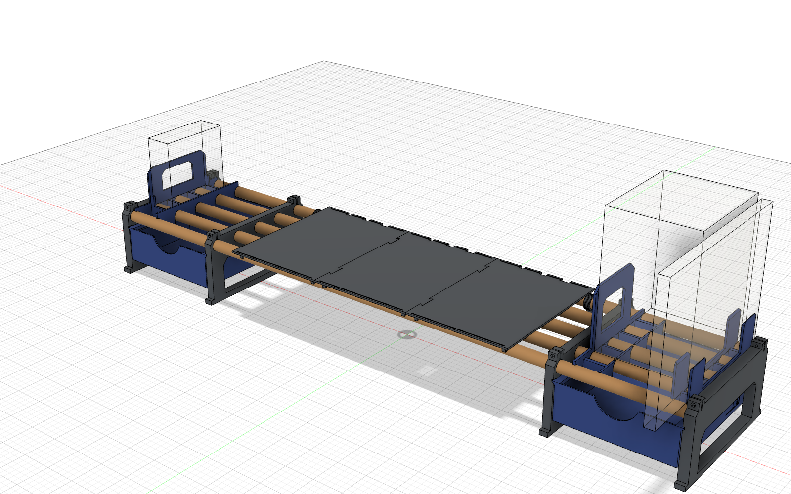

# Полка под монитор на пяти деревянных прутках Ø20

[English version](README.md)

Печатная полка-подставка под монитор. Каркас — **пять обычных деревянных прутков Ø20 × 1100 мм**.
Четыре печатные опоры держат прутки, под монитором площадка из трёх плиток, по бокам два выдвижных ящика
на V-пазах. Дополнительно: подставка MacBook с книжным упором, вертикальная подставка Mac mini, держатель MagSafe,
вставки Gridfinity в ящики, держатели штекеров и USB-хаба, кабельный лоток и подсветка стены (ESP32 + WLED).

> **Статус: в работе.** Всё смоделировано и проверено в CAD (пересечений нет, ход ящиков просчитан),
> но напечатана пока только часть. Перед печатью прочитай раздел «Что проверено».

## Главные размеры

| | |
|---|---|
| Габарит | ≈ 1104 × 244 мм, площадка на высоте ≈ 118 мм |
| Площадка | 540 × 244 мм, три плитки на «ласточкиных хвостах» |
| Под прутками | 95 мм |
| Ящики | снаружи 190 × 224 × 62, внутри 186 × 220, ход 145 мм, упор, снимаются |
| Прутки | 5 × Ø20 × 1100, шаг 50 мм, ось на высоте 105 мм |
| Делалась под | LG 29UC97C-B (6.2 кг). **Допустимая нагрузка не испытывалась.** |
| Пластик | ABS; ≈ 1.34 кг на полку и модули |
| Время | ≈ 84 ч в слое 0.20, ≈ 65 ч с быстрыми профилями |
| **Стол принтера** | **не меньше 245 × 200 мм** (опоры и плитки по 244 мм). Печаталось на FlyingBear Ghost 6. |

## Что купить

- 5 деревянных прутков Ø20 × 1100 мм. Обязательно измерь каждый штангенциркулем.
- 8 винтов M3 × 20 и 8 гаек M3 (хомуты на переднем и заднем прутке, по 2 на опору).
- По желанию: изолента или клеевая термоусадка, свечка или парафин, резиновая лента под ноги, скотч VHB для шайбы MagSafe.

## Какие опоры печатать

От прутков зависят только опоры.

- **Крайние** (`leg_end_*_D20.4`): глухие гнёзда D20.4, глубина 14 мм. Тонкий пруток обмотать изолентой.
- **Внутренние** (прутки проходят насквозь), два варианта:
  - `leg_inner_*_D20.4`: все гнёзда D20.4, для прутков ровно 20 мм. Начни с них.
  - `leg_inner_*_fitted_20.2-19.3-20.4-19.3-20.2`: под мои прутки (хорошие 20.0–20.1 на позициях 1/3/5,
    тонкие 19.0 на 2/4). Свои размеры — параметр `SOCK_INNER` в `source/fusion/deskshelf_v2_4c.py`.
- Защёлка `rod_clip_D19.8` для прутков 20.0, `rod_clip_D20.2` — для потолще.

## Порядок

1. **Пробники** из `stl/00-test-prints`: кольца D20.2/20.4/20.6 под прутки и пара «паз + бортик ящика».
2. Одна крайняя опора → примерить прутки → остальные опоры.
3. Плитки, защёлки, брусок 194 мм.
4. Правый ящик → проверить ход в пазу → левый ящик (если в 0.28 туго — левый в 0.20).
5. Модули и аксессуары.

Всё в одном файле Fusion: [`cad/all_in_one.f3d`](cad/all_in_one.f3d) — каждый набор отдельным компонентом, лишнее можно скрыть.

Подробно: [печать](docs/printing.md), [сборка](docs/assembly.md), [проблемы](docs/known-issues.md), [аксессуары](docs/accessories.md).
Наглядная схема сборки в 8 шагов: [`docs/assembly_visual_ru.html`](docs/assembly_visual_ru.html) (скачай и открой в браузере).

## Сборка коротко

1. **Прутки:** хорошие на позиции 1, 3, 5 (спереди назад), тонкие на 2 и 4. Хомут сжимается только до ≈ 19.6 мм.
2. Найди горб (покатай по полу) и ставь прутки **горбом вниз**. Бугры зашкурь, натри парафином. Длинные лучше отпилить по короткому.
3. Продень прутки через внутренние опоры, концы — в крайние. Тонкие концы — 4–5 витков изоленты.
4. Выставь внутреннюю опору бруском **bay_gauge** (194 мм) спереди и сзади, **вставь ящик** и только потом затяни M3.
5. Натри парафином скосы пазов. Ящик снимается: нажми выступ-упор через окно в опоре.
6. Плитки лежат на прутках свободно — так задумано. Защёлки rod_clip — на задний пруток у краёв плиток.
7. Резиновая лента под ноги, метки положения опор на прутках.

## Что проверено

| | |
|---|---|
| Пробники гнёзд и паза ящика | ✅ напечатаны, по ним выбраны зазоры |
| Плитка 1, крайняя правая опора | ✅ напечатаны в ABS |
| Внутренние опоры, ящики, остальные плитки, модули | ⏳ ещё не печатались |
| MagSafe и все аксессуары | 🧪 только проверка в CAD |
| Нагрузка, ползучесть ABS | ❌ не проверялось |

## Авторы и лицензия

- Идея — **GoCartDad, DadWel System** ([Printables 1693920](https://www.printables.com/model/1693920-modular-monitor-riser-desk-shelf-w-modular-drawers), CC BY-NC-SA 4.0).
  Эта версия смоделирована заново под пять прутков Ø20 и не содержит геометрии оригинала.
- Gridfinity — **Zack Freedman** (MIT).
- Модели: [@myratmyradov1997](https://github.com/myratmyradov1997), моделирование в Fusion 360 через API вместе с Claude Code.

Лицензия [CC BY-NC-SA 4.0](LICENSE): можно делиться и переделывать с указанием автора, не в коммерческих целях, под той же лицензией.
