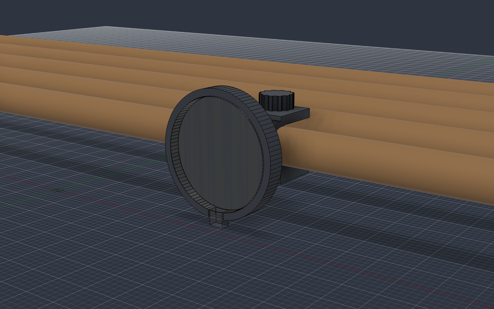

# Accessories

All accessories are **CAD-checked only** (no interference with the shelf, drawers travel freely), not printed yet.
Each one has its Fusion assembly in [`cad/`](../cad) and its generator in [`source/fusion/accessories/`](../source/fusion/accessories).

## MagSafe mount — `stl/03-magsafe`



- For a flat MagSafe-style puck **D58 × 6 mm** with the cable leaving from the **edge** (Anker/Ugreen 25 W type).
  Cup D66, pocket D58.4 × 5.5 (puck 0.5 mm proud), fix the puck with VHB tape.
- An open 9.5 mm notch in the bottom rim takes the cable boot — USB-C plugs never have to go through a hole.
- C-clamp D20.3 on the front rod, printed **M8 × 1.25 thumb screw** + printed nut (no metal, no tools).
  Tilt −40…+40°, slides along the rod.
- Print the cup face down with supports only in the pocket (30 g, 2 h). Screw and nut: 0.20 mm, no supports.
- Assembly: nut into the hex pocket from below → snap the cup onto the rod → screw in from the top.
- Other puck? Change the pocket parameters in `magsafe_mount_v3.py`.

## Gridfinity drawer inserts — `stl/04-gridfinity`

- Right drawer: 4 × 5 grid; left drawer: 4 × 3 in front of the divider + 4 × 1 behind it.
- **Each baseplate is two identical halves — print every plate file twice** (a full plate does not pass between the rim beams).
  Put one half in, slide it under its rim beam, then the second half (turned 180°).
- Starter bins 1×1, 1×2, 2×2 and a long 1×3 for Dupont wires, 7 units high (max under the drawer rim).
  Any standard Gridfinity bin up to 7u with lip / 8u without fits.
- Plates 76 g, starter bins 132 g, 0.28 mm, no supports.

## Front rod: plug holders and USB hub — `stl/05-front-rod`

- `acc_cable_clip_1/2/3`: C-rings open **upwards**, snapped on from below (the deck lies directly on the rods).
  Cables 3–4.5 mm press in from the front, the plug rests on a small shelf. Print on its side, 4.5–8.6 g.
- `acc_hub_cap_left/right`: two end cradles that hold a USB hub under rods 1 and 2, ports towards you.
  Default hub size **95 × 30 × 11 mm** — change `HUB_L/HUB_W/HUB_H` in the script for yours.

## Storage (experimental) — `stl/06-storage`

- Cable tray under the deck centre in 3 segments, joined with 8 printed pins (`tray_pin` × 8, `tray_lock_pin` × 2),
  hanging on two hangers on rods 4/5. Tool rail in the left bay, headphone stand (`hp_post` + `hp_foot` + `hp_pin`).
- **Heavy:** 627 g / 28.5 h in total — needs a lighter revision. Conflicts with the backlight brackets (same rod sections).

## Wall backlight (ESP32-C3 + WLED) — `stl/07-backlight`

- LED rail in 3 segments (3 × 212 mm, 634 mm of strip) lies on the deck along the back edge; the strip is stuck on a 45° face
  and lights the wall behind the monitor. Arches underneath let monitor cables pass.
- Brackets snap on rod 5; a box for an **ESP32-C3 Super Mini** hangs on rod 5 with the USB-C facing down.
- Optional 0.9 mm diffusers — print only in white/natural.
- Print 67 g / 4.6 h in 0.20 mm + 12.5 g diffusers.

Wiring (WS2812B 5 V):

```
USB-C 5 V 2–3 A ── ESP32-C3 Super Mini
   5V  ──┬───────────── strip +5V
        ═╪═ 1000 µF (≥ 6.3 V)
   GND ──┴───────────── strip GND
   GPIO2 ──[330 Ω]───── strip DIN
```

WLED (<https://install.wled.me>): LED type WS281x, GRB, length = visible LEDs (38 at 60/m), GPIO 2,
**max current 1500 mA** (current goes through the USB-C connector of the board). GPIO2 is a strapping pin —
if the board does not boot with the strip attached, use GPIO10 or GPIO4. For 12 V strips (WS2815) you need a buck converter.
